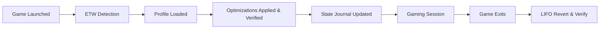

<h1 align="center">GameShift</h1>

<p align="center">
  <a href="https://github.com/lhceist41/GameShift/actions/workflows/ci.yml"></a>
  <a href="https://github.com/lhceist41/GameShift/releases/latest"></a>
  
  
  
  <a href="LICENSE"></a>
  <a href="https://github.com/lhceist41/GameShift/stargazers"></a>
</p>

<p align="center">
  <b>Intelligent, reversible Windows optimization for every game in your library.</b><br/>
  GameShift detects your games instantly, applies verified system-level optimizations per title,<br/>
  and restores everything the moment you stop playing - every change is verified and fully reversible, recorded in an atomic state journal.
</p>

---

<details>
<summary><strong>Table of Contents</strong></summary>

- [Features](#-features)
- [How It Works](#%EF%B8%8F-how-it-works)
- [Quick Start](#-quick-start)
- [System Requirements](#-system-requirements)
- [Safety & Transparency](#%EF%B8%8F-safety--transparency)
- [Anti-Cheat Compatibility](#-anti-cheat-compatibility)
- [FAQ](#-faq)
- [Contributing](#-contributing)
- [License](#-license)

</details>

---

## ✨ Features

> [!NOTE]
> Every optimization is fully reversible. GameShift records original values in a state journal before applying changes, verifies each change took effect, and auto-reverts in LIFO order when your game exits. The journal is written atomically (temp file → rename) so it is never left half-written, even during a hard shutdown.

### Quick Start

| Feature | Description |
|:--------|:------------|
| **One-Click Optimize** | Large "Optimize Now" button on the Dashboard applies all recommended system optimizations instantly. Shows a preview of what will be applied before clicking. Reverts with one click when done. |
| **Easy Mode** | Toggle in the Dashboard top-right to simplify the UI. Hides advanced pages and settings, leaving only the Dashboard and Settings visible. Defaults to Advanced Mode (all pages) for new installs. |

### Session Optimizations

These activate when a game launches and revert when the game closes.

| Optimization | What it does |
|:-------------|:-------------|
| **Process Priority Booster** | Elevates the game to High priority. Detects anti-cheat systems and automatically falls back to IFEO registry when runtime API calls are blocked. |
| **Service Suppression** | Pauses Windows Update, Update Orchestrator, Delivery Optimization, background transfers (BITS) and search indexing during gameplay, and starts them again when the game exits. Safety list protects critical services. |
| **Timer Resolution** | Advanced, off by default. Requests a 1 ms system timer resolution during gameplay. Runs on a dedicated windowless thread immune to minimize/occlusion resets. |
| **Power Plan Switching** | Switches from Balanced to the High Performance plan during gaming, if Windows has it, and back afterwards. Any other plan you chose is left alone, and Ryzen X3D processors with two CCDs stay on Balanced, which AMD's chipset driver needs to keep games on the V-Cache CCD. |
| **Core Pinning** | Advanced, off by default. One switch pins the game to the P-cores on Intel 12th-15th gen and AMD hybrid CPUs, or to the V-Cache CCD on Ryzen X3D processors with two CCDs, via the CPU Sets API. On hybrid CPUs it also keeps background processes on the E-cores, using soft affinity that cooperates with Intel Thread Director. |
| **Efficiency Mode Control** | One switch puts background processes in Windows 11 efficiency mode (EcoQoS), which keeps them on E-cores on hybrid CPUs, and turns off power throttling for the game (HighQoS). Rescans every 30 seconds to catch newly spawned processes. |

### Monitoring & Diagnostics

| Feature | Description |
|:--------|:------------|
| **Real-time Performance** | Live CPU, GPU, RAM, VRAM, and network ping telemetry with sparkline graphs. Pauses during gaming to eliminate polling overhead. |
| **DPC Latency Doctor** | ETW-based per-driver DPC/ISR attribution and a known problematic driver database. One-click fixes with rollback: turn off multi-plane overlay (MPO) for multi-monitor flicker, turn off USB selective suspend, switch the GPU to MSI mode, and network adapter settings. It no longer changes Windows boot settings (BCDEdit); values an earlier version set are undone by Restore All. If a CPU core reservation is set, DPC Doctor can remove it. |
| **DPC Load Monitor** | Passive sampling of DPC load (the share of CPU time spent in deferred procedure calls) during gaming, with configurable spike thresholds and toast notifications. |
| **GPU Advisories** | Detects HAGS (Hardware Accelerated GPU Scheduling) and Resizable BAR/SAM status. Shows recommendations if performance features are available but not enabled. |
| **Session History** | Post-session summary toast with duration, applied/failed optimization counts, and DPC statistics. Per-game tracking and statistics. |

### Persistent System Tweaks

Changes that persist across reboots and can be reverted at any time.

| Tweak | What it does |
|:------|:-------------|
| **GPU Scheduling (HAGS)** | Turns hardware-accelerated GPU scheduling on or off as recommended for your graphics card, and warns before turning it off where Frame Generation needs it. Requires a reboot. |
| **Memory Integrity (VBS/HVCI)** | The Dashboard banner can turn Memory Integrity off, which can cost a few percent of FPS on average when it is on. Not offered while FACEIT Anti-Cheat or Riot Vanguard is installed: FACEIT and Vanguard's On-Demand mode require it. Windows does not turn it back on for you; use Windows Security > Device security > Core isolation, or Restore All. Requires a reboot. |
| **Full-Screen Optimizations** | Per-game disable via GameConfigStore registry. |

Earlier versions also offered Game DVR, NTFS, kernel memory, page file, power throttling, memory compression, large pages, multimedia scheduler, kernel boot (BCDEdit) and CPU core reservation tweaks. They can no longer be applied: we found no measurement that shows a benefit on current Windows, or Microsoft documents the boot settings as debugging options. The multi-plane overlay, USB selective suspend and MSI mode fixes moved to DPC Doctor. Anything you applied with an earlier version can still be undone with **Restore All GameShift Tweaks** in Settings.

### Game Library & Profiles

- **Auto-detection** from Steam, Epic Games, GOG Galaxy, and Xbox/Game Pass install directories, plus a built-in database of 80+ popular game executables as fallback
- **19 built-in game profiles** with hardware-specific tuning and anti-cheat metadata for titles including Overwatch 2, Valorant, CS2, Fortnite, Apex Legends, Deadlock, osu!, Elden Ring, Arknights: Endfield, Wuthering Waves, and more
- **Per-game toggle control** for every optimization
- **Game-specific tips** shown as toast notifications on first launch (38 built-in tips covering performance settings, anti-cheat quirks, and common pitfalls)
- **Manual game adding** for any executable not in a scanned library

---

## ⚙️ How It Works



GameShift uses ETW (Event Tracing for Windows) kernel process events to detect game launches with sub-millisecond latency. When a game starts, the detection orchestrator matches it against your library, loads the appropriate profile, and applies each enabled optimization in sequence. Every change is recorded in a state journal with original and applied values so every modification can be deterministically reverted and verified when your game exits.

The journal is written to `%ProgramData%\GameShift\state.json` with atomic writes, which is the foundation for automatic recovery after an app crash or blue screen (a watchdog service plus a boot-recovery task). That automatic crash recovery is in active development and is not enabled in the current build; in normal use, GameShift reverts every change when your game exits.

Registry changes are monitored in real time via `RegNotifyChangeKeyValue`. If an external process (Windows Update, group policy, another tool) modifies a managed setting during a gaming session, GameShift detects and re-applies it automatically.

For games with kernel-level anti-cheat (EAC, BattlEye, RICOCHET, TencentACE), GameShift automatically falls back to IFEO (Image File Execution Options) registry-based settings instead of runtime API calls that the anti-cheat would block.

---

## 🚀 Quick Start

### Install (recommended)

1. Download `GameShift-Setup.exe` from the [Releases page](https://github.com/lhceist41/GameShift/releases/latest)
2. Run it and approve the administrator prompt. GameShift installs to `C:\Program Files\GameShift`, where only administrators can change its files, and adds a Start Menu shortcut.
3. Start GameShift from the Start Menu. It runs as **Administrator** (required for service control, registry access, timer resolution, and power plan management)
4. Complete the first-run wizard - GameShift auto-detects your installed games and scans your hardware

When you accept an update, the installed GameShift downloads the new installer into its own folder, checks it against the SHA-256 digest GitHub reports for the release, and runs it; the installer replaces the files and starts GameShift again.

To uninstall, first undo GameShift's lasting changes: open GameShift, uncheck **Easy Mode** in Settings and click **Restore All GameShift Tweaks**. It undoes the changes GameShift recorded (system tweaks, DPC Doctor fixes, kernel boot settings and Memory Integrity) and asks separately about a CPU core reservation and startup apps turned off with a "~" in front of their name. If you used Background Mode in an earlier version and GameShift ever closed unexpectedly while it was on, the `GlobalTimerResolutionRequests` value in `HKLM\SYSTEM\CurrentControlSet\Control\Session Manager\kernel` may still be set. GameShift did not record whether that value existed before, so it leaves it alone; delete it in Registry Editor if you did not set it yourself. Then remove GameShift in Windows Settings > Apps.

### Portable exe

The Releases page also has `GameShift.App.exe`, which runs without installing. Put it in a folder only administrators can change, such as `C:\Program Files\GameShift` (not Downloads, the Desktop, or a folder you created directly under `C:\`). GameShift runs with administrator rights, so anyone who can change files in its folder could run code with those rights. A portable copy updates by replacing its own file, and suggests switching to the installer once.

### Build from Source

**Prerequisites:** .NET 9 SDK, Visual Studio 2022 17.12+, Windows 10 21H2+ (x64)

```bash
git clone https://github.com/lhceist41/GameShift.git
cd GameShift
dotnet restore
dotnet build --configuration Release
dotnet run --project src/GameShift.App
```

---

## 💻 System Requirements

| Requirement | Details |
|:------------|:--------|
| **OS** | Windows 10 21H2+ / Windows 11 22H2+ |
| **Architecture** | x64 |
| **RAM** | 8 GB minimum, 16 GB+ recommended |
| **Runtime** | .NET 9 (bundled with release builds) |
| **Privileges** | Administrator |

> [!NOTE]
> Some features require specific Windows versions. CPU Sets scheduling requires Windows 11 22H2+. All features degrade gracefully on older builds.

---

## 🛡️ Safety & Transparency

> [!CAUTION]
> Create a System Restore point before your first use. GameShift modifies system-level settings that are all reversible, but a restore point provides an extra safety net.

### Reversibility and the state journal

1. **State Journal**  - Every optimization writes its original and applied values to `%ProgramData%\GameShift\state.json` using atomic writes (temp file → rename). Reverts happen in LIFO order with post-revert verification when your game exits.
2. **Automatic crash recovery (in development)**  - The journal is designed so a watchdog service and a boot-recovery task can restore your system after an app crash, blue screen, or power loss. These components are not enabled in the current build; in normal use, reverts occur when your game exits.

### What GameShift changes (and how it reverts)

- **Services**  - Temporarily pauses non-essential services. Original start types recorded in journal, restored on session end.
- **Registry keys**  - Writes IFEO entries and a few per-game values for built-in games. All original values captured before any write and verified after revert.
- **Power plans**  - Switches from Balanced to High Performance during a game. Your original plan GUID is saved and restored.
- **Process priority & scheduling**  - Elevates game priority and assigns CPU sets. All released on game exit.
- **BCD settings**  - Only turning Memory Integrity off changes a boot setting (`hypervisorlaunchtype`), and turning it back on restores it. Kernel tuning values an earlier version set are undone by Restore All while they still have the value GameShift set.
- **Interrupt settings**  - DPC Doctor can switch the GPU to MSI mode, with rollback. Interrupt changes an earlier version made are undone by Restore All.

### Why administrator privileges are required

Windows protects service configuration, `HKLM` registry access, timer resolution, ETW sessions, and power plan management behind administrator permissions. GameShift makes **no network calls** except to check for updates on GitHub, collects **no telemetry**, and stores **all data locally**.

### Transparency

- Source code is fully open and auditable (see [`src/`](src/))
- All optimization logic lives in [`src/GameShift.Core/Optimization/`](src/GameShift.Core/Optimization/)

---

## 🔒 Anti-Cheat Compatibility

GameShift includes built-in anti-cheat detection and automatic compatibility adjustments:

| Anti-Cheat | Status | Approach |
|:-----------|:-------|:---------|
| **Riot Vanguard** (Valorant, LoL) | ✅ Fully compatible | GameShift does not turn off Memory Integrity (VBS/HVCI) while Vanguard is installed, because Vanguard's On-Demand mode requires it. |
| **Easy Anti-Cheat** (Fortnite, Apex, Rust, Elden Ring) | ✅ Fully compatible | IFEO registry fallback for priority. |
| **BattlEye** (Arknights: Endfield, PUBG) | ✅ Fully compatible | IFEO registry fallback. |
| **RICOCHET** (Call of Duty) | ✅ Fully compatible | IFEO registry fallback. |
| **TencentACE** (Wuthering Waves) | ✅ Fully compatible | IFEO registry fallback. |
| **Valve Anti-Cheat** (CS2, Deadlock) | ✅ Fully compatible | User-mode only; no restrictions on system-level tools. |
| **FACEIT AC** | ✅ Fully compatible | GameShift does not turn off Memory Integrity (VBS/HVCI) while FACEIT Anti-Cheat is installed, because FACEIT requires it. |

GameShift does **not** inject into game processes, does **not** modify game files, and does **not** hook into game memory. All optimizations operate at the Windows system level using standard Win32 APIs and registry settings.

> [!IMPORTANT]
> Anti-cheat detection is automatic via service queries, driver files, and registry keys. When kernel-level anti-cheat blocks runtime process manipulation, GameShift switches to IFEO PerfOptions. Always verify with your specific game's Terms of Service.

---

## ❓ FAQ

<details>
<summary><strong>Will this get me banned?</strong></summary>
<br/>
No. GameShift modifies Windows system settings - power plans, timer resolution, service configuration, memory management. It does not touch game files, game memory, or game processes in ways that anti-cheat systems flag. The same underlying techniques (standby list management, timer resolution, interrupt affinity) are used by thousands of competitive players through standalone tools like ISLC, Process Lasso, and Timer Resolution.
</details>

<details>
<summary><strong>Does it work with Game Pass / Xbox games?</strong></summary>
<br/>
Yes. GameShift scans Xbox/Game Pass install directories alongside Steam, Epic, and GOG. System-level optimizations work identically on all titles. Process priority elevation may be limited on some UWP-packaged titles due to Windows sandboxing.
</details>

<details>
<summary><strong>Can I use it on a laptop?</strong></summary>
<br/>
Yes. GameShift is particularly effective on laptops where Windows aggressively throttles performance to save battery. The switch to High Performance lasts only while a game runs, so your usual plan is back when you stop playing.
</details>

<details>
<summary><strong>What happens if my PC crashes during optimization?</strong></summary>
<br/>
GameShift reverts every change when your game exits, and records all original values in <code>%ProgramData%\GameShift\state.json</code> using atomic writes, so the journal is never corrupted even during a hard shutdown. Automatic recovery after an app crash or blue screen (a watchdog service plus a boot-recovery task) is in active development and is not enabled in the current build. As an extra safety net, create a System Restore point before first use, and the lasting changes GameShift recorded (system tweaks, DPC Doctor fixes, kernel boot settings and Memory Integrity) can be undone any time from Settings via "Restore All GameShift Tweaks".
</details>

<details>
<summary><strong>What is the "GameShift Performance" power plan?</strong></summary>
<br/>
Earlier versions created it for Background Mode, which has been removed. When you start this version, GameShift deletes the plan. If it was still your active plan, GameShift first switches you to Balanced (or to another existing plan if Balanced is missing), because it never recorded which plan you used before; choose your preferred plan in Control Panel > Power Options. If GameShift closed unexpectedly during a game while Background Mode was on, it also re-enables the Windows maintenance tasks Background Mode paused and tells you which ones.
</details>

<details>
<summary><strong>Do I need an Intel hybrid CPU to benefit?</strong></summary>
<br/>
No. CPU Sets scheduling is a hybrid-only feature, but everything else - timer resolution, service suppression, power plan switching, DPC Doctor - works on any modern CPU from Intel or AMD.
</details>

<details>
<summary><strong>Why does Windows Defender flag GameShift?</strong></summary>
<br/>
GameShift modifies Windows services, writes to protected registry keys, manages ETW sessions, and changes system timer resolution. These behaviors are sometimes flagged by heuristic scanners. The application is open source and fully auditable. If Defender quarantines the executable, add an exclusion for <code>GameShift.App.exe</code>, or build from source.
</details>

---

## 🤝 Contributing

GameShift is a solo project, and I'd love the help. Bug reports, fixes, and ideas are all welcome. See [CONTRIBUTING.md](CONTRIBUTING.md) for how to get set up.

```bash
git clone https://github.com/lhceist41/GameShift.git
cd GameShift
git checkout -b feature/your-feature
dotnet test
git commit -m "describe what you changed"
git push origin feature/your-feature
```

Found a bug or want a feature? Open an issue on the [Issues page](https://github.com/lhceist41/GameShift/issues). I read all of them.

---

## 📄 License

This project is licensed under the [MIT License](LICENSE).

---

<p align="center">
  If GameShift improved your gaming experience, consider leaving a ⭐ on the repo.
</p>
