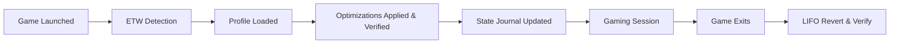

<h1 align="center">GameShift</h1>

<p align="center">
  <a href="https://github.com/lhceist41/GameShift/actions/workflows/ci.yml"></a>
  <a href="https://github.com/lhceist41/GameShift/releases/latest"></a>
  
  
  
  <a href="LICENSE"></a>
  <a href="https://github.com/lhceist41/GameShift/stargazers"></a>
</p>

<p align="center">
  <b>Intelligent, reversible Windows optimization for every game in your library.</b><br/>
  GameShift detects your games instantly, applies verified system-level optimizations per title,<br/>
  and restores everything the moment you stop playing - every change is verified and fully reversible, recorded in an atomic state journal.
</p>

---

<details>
<summary><strong>Table of Contents</strong></summary>

- [Features](#-features)
- [How It Works](#%EF%B8%8F-how-it-works)
- [Quick Start](#-quick-start)
- [System Requirements](#-system-requirements)
- [Safety & Transparency](#%EF%B8%8F-safety--transparency)
- [Anti-Cheat Compatibility](#-anti-cheat-compatibility)
- [FAQ](#-faq)
- [Contributing](#-contributing)
- [License](#-license)

</details>

---

## ✨ Features

> [!NOTE]
> Every optimization is fully reversible. GameShift records original values in a state journal before applying changes, verifies each change took effect, and auto-reverts in LIFO order when your game exits. The journal is written atomically (temp file → rename) so it is never left half-written, even during a hard shutdown.

### Quick Start

| Feature | Description |
|:--------|:------------|
| **One-Click Optimize** | The **Optimize now** button on Home applies the session optimizations switched on in **During games** without waiting for a game (Quick Optimize); a link beside it lists what it applies. **End session** reverts them. |

### Session Optimizations

These activate when a game launches and revert when the game closes. The **During games** page shows each one with its default switch and its result in the running session.

| Optimization | What it does |
|:-------------|:-------------|
| **Process Priority Booster** | Elevates the game to High priority. Detects anti-cheat systems and automatically falls back to IFEO registry when runtime API calls are blocked. |
| **Service Suppression** | Pauses Windows Update, Update Orchestrator, Delivery Optimization, background transfers (BITS) and search indexing during gameplay, and starts them again when the game exits. Safety list protects critical services. |
| **Timer Resolution** | Advanced, off by default. Requests a 1 ms system timer resolution during gameplay. Runs on a dedicated windowless thread immune to minimize/occlusion resets. |
| **Power Plan Switching** | Switches from Balanced to the High Performance plan during gaming, if Windows has it, and back afterwards. Any other plan you chose is left alone, and Ryzen X3D processors with two CCDs stay on Balanced, which AMD's chipset driver needs to keep games on the V-Cache CCD. |
| **Core Pinning** | Advanced, off by default. One switch pins the game to the P-cores on Intel 12th-15th gen and AMD hybrid CPUs, or to the V-Cache CCD on Ryzen X3D processors with two CCDs, via the CPU Sets API. On hybrid CPUs it also keeps background processes on the E-cores, using soft affinity that cooperates with Intel Thread Director. |
| **Efficiency Mode Control** | One switch puts background processes in Windows 11 efficiency mode (EcoQoS), which on hybrid CPUs lets Windows prefer the E-cores for them, and turns off power throttling for the game (HighQoS). Rescans every 30 seconds to catch newly spawned processes. |

### Monitoring & Diagnostics

| Feature | Description |
|:--------|:------------|
| **Live readings** | Home shows DPC load (measured while a game runs), ping, CPU and GPU use, and memory in use, each with a small graph. A reading your PC cannot provide says "not available" instead of showing 0. The CPU, GPU, memory and ping readings pause while a game runs, and Home stops updating while its window is hidden. |
| **Latency Doctor** | ETW-based per-driver DPC/ISR attribution and a known problematic driver database. One-click fixes with rollback: turn off multi-plane overlay (MPO) for multi-monitor flicker, turn off USB selective suspend, switch the GPU to MSI mode, and network adapter settings. It no longer changes Windows boot settings (BCDEdit); values an earlier version set are undone by Restore All. If a CPU core reservation is set, Latency Doctor can remove it. |
| **DPC Load Monitor** | Passive sampling of DPC load (the share of CPU time spent in deferred procedure calls) during gaming, with configurable spike thresholds and toast notifications. |
| **GPU Advisories** | The System page shows HAGS (Hardware Accelerated GPU Scheduling) and Resizable BAR/SAM status, with recommendations if performance features are available but not enabled. |
| **Session History** | After each game, a message shows the session length, how many changes were applied and failed, whether all of them were undone (or which ones are still active), and the DPC load. Home lists your last five sessions, and per-game statistics are kept. |

### Persistent System Tweaks

Changes that persist across reboots and can be reverted at any time. The **Lasting changes** page lists them.

| Tweak | What it does |
|:------|:-------------|
| **GPU Scheduling (HAGS)** | Turns hardware-accelerated GPU scheduling on or off as recommended for your graphics card, and warns before turning it off where Frame Generation needs it. Requires a reboot. |
| **Memory Integrity (VBS/HVCI)** | A notice on Home can turn Memory Integrity off, which can cost a few percent of FPS on average when it is on. Not offered while FACEIT Anti-Cheat or Riot Vanguard is installed: FACEIT and Vanguard's On-Demand mode require it. Windows does not turn it back on for you; use **Re-enable Memory Integrity** in Settings, Windows Security > Device security > Core isolation, or Restore All. Requires a reboot. |

Earlier versions also offered Game DVR, NTFS, kernel memory, page file, power throttling, memory compression, large pages, multimedia scheduler, kernel boot (BCDEdit) and CPU core reservation tweaks. They can no longer be applied: we found no measurement that shows a benefit on current Windows, or Microsoft documents the boot settings as debugging options. The multi-plane overlay, USB selective suspend and MSI mode fixes moved to Latency Doctor. Anything you applied with an earlier version can still be undone with **Restore All GameShift Tweaks** on the **Lasting changes** page.

### Game Library & Profiles

- **Auto-detection** from Steam, Epic Games, GOG Galaxy, and Xbox/Game Pass install directories; the built-in games are also recognised by their executable names wherever they are installed
- **19 built-in games** with anti-cheat metadata and notes for titles including Overwatch, Valorant, CS2, Fortnite, Apex Legends, Deadlock, osu!, Elden Ring, Arknights: Endfield, Wuthering Waves, and more; the Overwatch, CS2, Apex Legends and Final Fantasy XIV cards in Settings also show whether GPU scheduling (HAGS) is set as GameShift recommends for your PC
- **Per-game toggle control** for every optimization
- **Game-specific tips** for Overwatch, Valorant, League of Legends, Deadlock and osu!, each shown once as a toast notification (performance settings, anti-cheat quirks, and common pitfalls)
- **Manual game adding** for any executable not in a scanned library

---

## ⚙️ How It Works



GameShift uses ETW (Event Tracing for Windows) kernel process events to detect game launches with sub-millisecond latency. When a game starts, the detection orchestrator matches it against your library, loads the appropriate profile, and applies each enabled optimization in sequence. Every change is recorded in a state journal with original and applied values so every modification can be deterministically reverted and verified when your game exits.

The journal is written to `%ProgramData%\GameShift\state.json` with atomic writes, and GameShift reverts every change when your game exits. If GameShift did not close normally during a session (an app crash, a blue screen, a power loss or a sign-out that cut it off), it undoes that session's recorded changes the next time it starts, before it can start another session, and tells you what it did. It does this only when the journal file and its folder can be written by administrators alone; a journal a standard user could have changed is set aside and never acted on.

For games with kernel-level anti-cheat (EAC, EA Javelin, BattlEye, RICOCHET, TencentACE), GameShift automatically falls back to IFEO (Image File Execution Options) registry-based settings instead of runtime API calls that the anti-cheat would block.

---

## 🚀 Quick Start

### Install (recommended)

1. Download `GameShift-Setup.exe` from the [Releases page](https://github.com/lhceist41/GameShift/releases/latest)
2. Run it and approve the administrator prompt. GameShift installs to `C:\Program Files\GameShift`, where only administrators can change its files, and adds a Start Menu shortcut.
3. Start GameShift from the Start Menu. It runs as **Administrator** (required for service control, registry access, timer resolution, and power plan management)
4. Complete the first-run wizard - GameShift auto-detects your installed games and scans your hardware

When you accept an update, the installed GameShift downloads the new installer into its own folder, checks it against the SHA-256 digest GitHub reports for the release, and runs it; the installer replaces the files and starts GameShift again.

To uninstall, remove GameShift in Windows Settings > Apps. The uninstaller removes GameShift's startup task and asks whether to undo the lasting changes GameShift recorded for your Windows account: system tweaks, Latency Doctor fixes, kernel boot settings and Memory Integrity. A CPU core reservation and startup apps turned off with a "~" in front of their name need your own choice, so the uninstaller does not undo them; for those, and for changes recorded in another Windows account, use **Restore All GameShift Tweaks** on the **Lasting changes** page of GameShift before you uninstall. If something could not be undone, the uninstaller says so and `%ProgramData%\GameShift\logs\restore-tweaks.txt` lists it. If you used Background Mode in an earlier version and GameShift ever closed unexpectedly while it was on, the `GlobalTimerResolutionRequests` value in `HKLM\SYSTEM\CurrentControlSet\Control\Session Manager\kernel` may still be set. GameShift did not record whether that value existed before, so it leaves it alone; delete it in Registry Editor if you did not set it yourself.

### Portable exe

The Releases page also has `GameShift.App.exe`, which runs without installing. Put it in a folder only administrators can change, such as a folder you create under `C:\Program Files` (not Downloads, the Desktop, or a folder you created directly under `C:\`). GameShift runs with administrator rights, so anyone who can change files in its folder could run code with those rights.

A portable copy offers once to install GameShift. When you accept that offer or an update, it downloads the installer into `C:\Program Files\GameShift`, checks it the same way, and runs it; GameShift is then installed there with your settings and game library, and the installed copy starts. GameShift does not delete the portable file; you can delete it yourself. If GameShift is already installed, a portable copy offers to start the installed copy instead.

### Build from Source

**Prerequisites:** .NET 10 SDK, Visual Studio 2026 (18.0+), Windows 10 21H2+ (x64)

```bash
git clone https://github.com/lhceist41/GameShift.git
cd GameShift
dotnet restore
dotnet build --configuration Release
dotnet run --project src/GameShift.App
```

---

## 💻 System Requirements

| Requirement | Details |
|:------------|:--------|
| **OS** | Windows 10 21H2+ / Windows 11 22H2+ |
| **Architecture** | x64 |
| **RAM** | 8 GB minimum, 16 GB+ recommended |
| **Runtime** | .NET 10 (bundled with release builds) |
| **Privileges** | Administrator |

> [!NOTE]
> Some features require specific Windows versions. CPU Sets scheduling requires Windows 11 22H2+. All features degrade gracefully on older builds.

---

## 🛡️ Safety & Transparency

> [!CAUTION]
> Create a System Restore point before your first use. GameShift modifies system-level settings that are all reversible, but a restore point provides an extra safety net.

### Reversibility and the state journal

1. **State Journal**  - Every optimization writes its original and applied values to `%ProgramData%\GameShift\state.json` using atomic writes (temp file → rename). Reverts happen in LIFO order with post-revert verification when your game exits.
2. **Recovery at the next start**  - If GameShift did not close normally during a session (an app crash, blue screen, or power loss), it undoes the changes recorded for that session the next time it starts, then shows one notice naming anything it could not undo. It acts only on a journal that administrators alone can write. A watchdog service and a boot-recovery task that would recover without starting GameShift are not part of the current build.

### What GameShift changes (and how it reverts)

- **Services**  - Temporarily stops non-essential services. The services it stopped are recorded in the journal and started again on session end; their start types are not changed.
- **Registry keys**  - Writes IFEO entries. All original values captured before any write and verified after revert.
- **Power plans**  - Switches from Balanced to High Performance during a game. Your original plan GUID is saved and restored.
- **Process priority & scheduling**  - Elevates game priority and assigns CPU sets. All released on game exit.
- **Firewall**  - GameShift adds no firewall rules. At startup it removes the allow rules earlier versions added for Overwatch 2, Valorant, League of Legends and Deadlock.
- **BCD settings**  - Only turning Memory Integrity off changes a boot setting (`hypervisorlaunchtype`), and turning it back on restores it. Kernel tuning values an earlier version set are undone by Restore All while they still have the value GameShift set.
- **Interrupt settings**  - Latency Doctor can switch the GPU to MSI mode, with rollback. Interrupt changes an earlier version made are undone by Restore All.

### Why administrator privileges are required

Windows protects service configuration, `HKLM` registry access, timer resolution, ETW sessions, and power plan management behind administrator permissions. GameShift's only network activity is checking GitHub for updates (and downloading one when you accept it) and the ping reading on Home, which pings a host you can change in Settings (`8.8.8.8` by default). It collects **no telemetry** and stores **all data locally**.

### Transparency

- Source code is fully open and auditable (see [`src/`](src/))
- All optimization logic lives in [`src/GameShift.Core/Optimization/`](src/GameShift.Core/Optimization/)

---

## 🔒 Anti-Cheat Compatibility

GameShift includes built-in anti-cheat detection and automatic compatibility adjustments:

| Anti-Cheat | Status | Approach |
|:-----------|:-------|:---------|
| **Riot Vanguard** (Valorant, LoL) | ✅ Fully compatible | GameShift does not turn off Memory Integrity (VBS/HVCI) while Vanguard is installed, because Vanguard's On-Demand mode requires it. |
| **Easy Anti-Cheat** (Fortnite, Rust, Elden Ring) | ✅ Fully compatible | IFEO registry fallback for priority. |
| **EA Javelin** (Apex Legends) | ✅ Handled like Easy Anti-Cheat | IFEO registry fallback for priority. |
| **BattlEye** (PUBG) | ✅ Fully compatible | IFEO registry fallback. |
| **RICOCHET** (Call of Duty) | ✅ Fully compatible | IFEO registry fallback. |
| **TencentACE** (Wuthering Waves, Arknights: Endfield) | ✅ Fully compatible | IFEO registry fallback. |
| **Valve Anti-Cheat** (CS2, Deadlock) | ✅ Fully compatible | User-mode only; no restrictions on system-level tools. |
| **FACEIT AC** | ✅ Fully compatible | GameShift does not turn off Memory Integrity (VBS/HVCI) while FACEIT Anti-Cheat is installed, because FACEIT requires it. |

GameShift does **not** inject into game processes, does **not** modify game files, and does **not** hook into game memory. All optimizations operate at the Windows system level using standard Win32 APIs and registry settings.

> [!IMPORTANT]
> Anti-cheat detection is automatic via service queries, driver files, and registry keys. When kernel-level anti-cheat blocks runtime process manipulation, GameShift switches to IFEO PerfOptions. Always verify with your specific game's Terms of Service.

---

## ❓ FAQ

<details>
<summary><strong>Will this get me banned?</strong></summary>
<br/>
No. GameShift modifies Windows system settings - power plans, timer resolution, service configuration, process priority. It does not touch game files, game memory, or game processes in ways that anti-cheat systems flag. The same underlying techniques (process priority, timer resolution) are used by thousands of competitive players through standalone tools like Process Lasso and Timer Resolution.
</details>

<details>
<summary><strong>Does it work with Game Pass / Xbox games?</strong></summary>
<br/>
Yes. GameShift scans Xbox/Game Pass install directories alongside Steam, Epic, and GOG. System-level optimizations work identically on all titles. Process priority elevation may be limited on some UWP-packaged titles due to Windows sandboxing.
</details>

<details>
<summary><strong>Can I use it on a laptop?</strong></summary>
<br/>
Yes. GameShift is particularly effective on laptops where Windows aggressively throttles performance to save battery. The switch to High Performance lasts only while a game runs, so your usual plan is back when you stop playing.
</details>

<details>
<summary><strong>What happens if my PC crashes during optimization?</strong></summary>
<br/>
GameShift reverts every change when your game exits, and records all original values in <code>%ProgramData%\GameShift\state.json</code> using atomic writes, so the journal is never corrupted even during a hard shutdown. If GameShift itself crashes or the PC loses power mid-session, GameShift undoes that session's recorded changes the next time you start it, and tells you if anything could not be undone. It does not run a separate watchdog service or boot task for this, so the changes stay until GameShift is started again. As an extra safety net, create a System Restore point before first use, and the lasting changes GameShift recorded (system tweaks, Latency Doctor fixes, kernel boot settings and Memory Integrity) can be undone any time with "Restore All GameShift Tweaks" on the Lasting changes page.
</details>

<details>
<summary><strong>What is the "GameShift Performance" power plan?</strong></summary>
<br/>
Earlier versions created it for Background Mode, which has been removed. When you start this version, GameShift deletes the plan. If it was still your active plan, GameShift first switches you to Balanced (or to another existing plan if Balanced is missing), because it never recorded which plan you used before; choose your preferred plan in Control Panel > Power Options. If GameShift closed unexpectedly during a game while Background Mode was on, it also re-enables the Windows maintenance tasks Background Mode paused and tells you which ones.
</details>

<details>
<summary><strong>Do I need an Intel hybrid CPU to benefit?</strong></summary>
<br/>
No. CPU Sets scheduling is a hybrid-only feature, but everything else - timer resolution, service suppression, power plan switching, Latency Doctor - works on any modern CPU from Intel or AMD.
</details>

<details>
<summary><strong>Why does Windows Defender flag GameShift?</strong></summary>
<br/>
GameShift modifies Windows services, writes to protected registry keys, manages ETW sessions, and changes system timer resolution. These behaviors are sometimes flagged by heuristic scanners. The application is open source and fully auditable. If Defender quarantines the executable, add an exclusion for <code>GameShift.App.exe</code>, or build from source.
</details>

---

## 🤝 Contributing

GameShift is a solo project, and I'd love the help. Bug reports, fixes, and ideas are all welcome. See [CONTRIBUTING.md](CONTRIBUTING.md) for how to get set up.

```bash
git clone https://github.com/lhceist41/GameShift.git
cd GameShift
git checkout -b feature/your-feature
dotnet test
git commit -m "describe what you changed"
git push origin feature/your-feature
```

Found a bug or want a feature? Open an issue on the [Issues page](https://github.com/lhceist41/GameShift/issues). I read all of them.

---

## 📄 License

This project is licensed under the [MIT License](LICENSE).

---

<p align="center">
  If GameShift improved your gaming experience, consider leaving a ⭐ on the repo.
</p>
